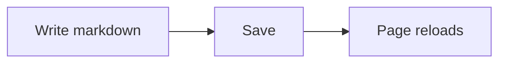

# Welcome

A starter page showing what `markdownlive` renders. Delete or edit freely.

!!! tip "Admonition"
    Callouts, `==mark==`, ==highlighted== text and :material-check: icons all work.

=== "Tab one"
    Content tabs.
=== "Tab two"
    Another tab.

Inline math $E = mc^2$ and a block:

$$
\int_0^1 x^2\,dx = \tfrac{1}{3}
$$

- [x] Task lists
- [ ] Footnotes[^1]

The HTML spec is a good example of an abbreviation.

*[HTML]: HyperText Markup Language

[^1]: Hover to preview.
